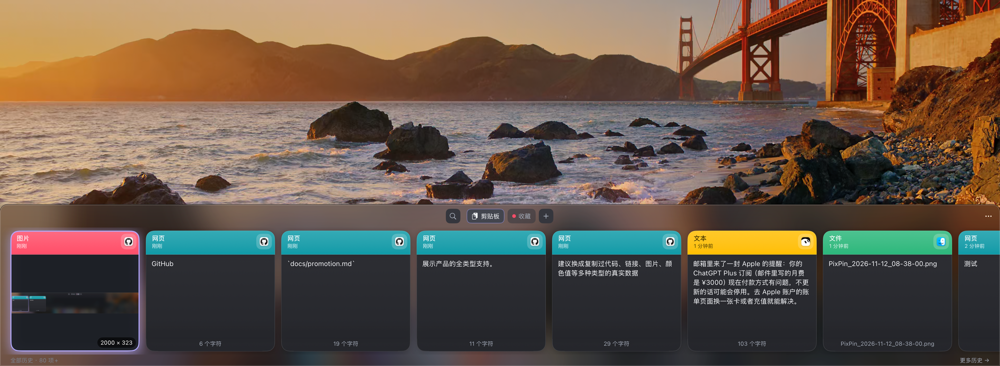

<p align="center">
  <a href="README.md">简体中文</a> | <b>English</b>
</p>

<h1 align="center">📋 Clipboard Manager for macOS</h1>

<p align="center">
  A native clipboard history manager for macOS
</p>

<p align="center">
  
  
  
  
</p>

<p align="center">
  
</p>

A native macOS clipboard history manager that lives in your menu bar. Press `⌘⇧V` to open a card-style board at the bottom of the screen, then browse, search, favorite, and paste anything you've copied: text, links, images, code, files, and even color values.

Promotion materials: [docs/promotion.md](docs/promotion.md).

## Features

### Recording and Preview
- **All content types**: text, links, images, code, and file paths are classified automatically. `#RRGGBB` values appear as color cards.
- **Image OCR**: text in copied images is extracted locally with the Vision framework and included in search.
- **Smart dedup**: identical content is kept once and moved to the front.
- **Excluded apps**: content copied from apps on your exclusion list is not recorded.

### Board UI
- A frosted-glass card strip at the bottom of the screen, with opaque cards. Fully supports light and dark mode.
- Click to select, **double-click to paste** into the current app.
- Quick search (`⌘F`) and filters for Clipboard / Favorites / Boards.

### Paste and Copy
- **Double-click or Enter**: paste the selected item into the app you were using. Focus is returned first, then `⌘V` is simulated.
- **`⌘C`**: copy to the clipboard without pasting. You can also copy as plain text.
- Items written by the app are marked internally, so they are not recorded again.

### Favorites
- Star individual items. Favorited items are not removed by history cleanup.
- Create multiple **boards** with custom names and colors to organize snippets.

### Storage and Privacy
- Local SQLite storage in `~/Library/Application Support/ClipboardManagerMac/`.
- Configurable retention (default 30 days; 0 = forever) and maximum item count (default 50,000).
- One-click database backup.
- Runs entirely locally with **no network requests**.

## Shortcuts

| Key | Action |
| --- | --- |
| `⌘⇧V` | Show / hide the board (global shortcut, customizable in Preferences) |
| `↑` `↓` `←` `→` | Move the selection between cards |
| `Enter` | Paste the selected item into the current app |
| `⌘C` | Copy the selected item to the clipboard |
| `F` | Favorite / unfavorite |
| `Delete` | Delete the selected item |
| `Space` | Open the large preview |
| `⌘F` | Focus the search field |
| `Esc` | Close the board and return focus to the previous app |

## Requirements

- macOS 14.0 or later
- Apple Silicon or Intel Mac

## Build and Run

```bash
# Build the full app (with icon and signing) after cloning
bash scripts/build_app.sh

# Output
open build/剪贴板管理器.app
```

To compile and debug with SwiftPM only:

```bash
swift build
.build/debug/ClipboardManagerMac
```

On first use, enable "Launch at login" in Preferences so the app stays quietly in the menu bar.

## Permissions

| Permission | Purpose | Required |
| --- | --- | --- |
| Accessibility | Sends `⌘V` to the target app after double-click / Enter | Optional. Without it, copy and press `⌘V` manually |
| None | OCR runs fully locally; no screen recording or network access needed | — |

## Project Structure

```
Sources/ClipboardManagerMac/
├── App/          # App lifecycle, panel control, global shortcuts, menu bar
├── Services/     # Clipboard read/write, capture pipeline, OCR
├── Data/         # SQLite database and repositories
├── Domain/       # Data models and settings
└── UI/           # SwiftUI views and design tokens
scripts/
├── build_app.sh  # One-step .app bundle build
└── make_icon.swift # App icon generator
```

## Technical Notes

- **NSPanel + NSVisualEffectView**: a borderless, non-activating bottom panel. Focus returns to the previous app on close, so the following `⌘V` lands in the right place.
- **changeCount polling + internal write marker**: the system pasteboard is polled every 0.35s. The app's own writes are identified by a private pasteboard type to avoid recording loops. A short memory guard prevents other tools from overwriting the clipboard during copy.
- **Cooperative activation on macOS 14+**: handles three launch scenarios: double-click, relaunch, and login item.
