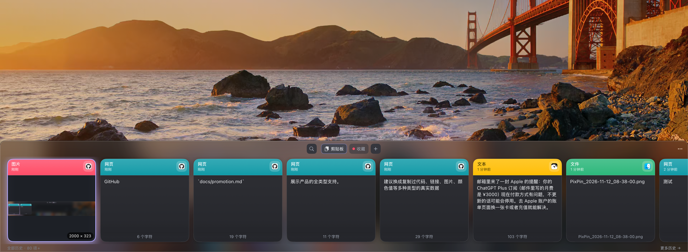

# 推广素材

## 英文 README 简介

> # Clipboard Manager for macOS
>
> A native macOS clipboard history manager. It lives in your menu bar, and a press of `⌘⇧V` opens a card-style board at the bottom of the screen where you can browse, search, favorite, and paste anything you've copied: text, links, images, code, files, and even color values.
>
> - **All content types**, with `#RRGGBB` values shown as color previews
> - **Local OCR** on copied images, so text inside screenshots is searchable
> - **Smart dedup** and an app exclusion list
> - **Double-click or Enter** to paste straight into the active app
> - **Favorites and boards** to organize reusable snippets
> - **100% local**: SQLite storage, no network requests
>
> Built with Swift Package Manager, AppKit, and SwiftUI. No third-party dependencies. Requires macOS 14+.

## 中文发布文案（V2EX / 少数派 / 掘金）

> 做了一款原生 macOS 剪贴板管理器，分享一下。
>
> 按 `⌘⇧V` 在屏幕底部呼出画板，以卡片流浏览最近复制的文本、链接、图片、代码、文件和颜色值。双击直接粘贴回当前应用，图片会在本地 OCR 提取文字，搜索时一并命中。
>
> 技术上没有第三方依赖，基于 SwiftPM + AppKit + SwiftUI。几个踩过的坑：无边框 NSPanel 关闭时要把焦点还给上一个应用，否则随后的 `⌘V` 会落空；剪贴板监听用 changeCount 轮询，并用私有 pasteboard 类型标记自身写入，避免回环录制。
>
> 数据全部存在本地 SQLite，没有任何网络请求。源码与下载：<仓库链接>

## 发布前检查

- 补充画板截图或 GIF。截图建议：
  - 使用真实桌面背景，体现从屏幕底部呼出的场景。
  - 使用专门准备的演示数据，覆盖代码、链接、颜色值、图片、文件和普通文本等类型。
  - 避免出现个人信息（如邮件、账单、账号）以及开发过程中的内部文字。
  - 截取时放大画板区域，保证卡片文字清晰可读。
- 说明应用尚未签名公证，首次打开需要右键选择「打开」。
- 添加 GitHub Topics：`clipboard-manager`、`macos`、`swift`、`swiftui`。
