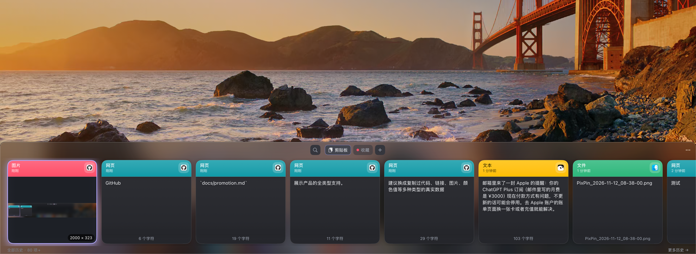

# 剪贴板管理器 v1.0.0 / Clipboard Manager v1.0.0

首个正式版本，原生 macOS 剪贴板历史管理工具。按 `⌘⇧V` 呼出屏幕底部画板，浏览、搜索、收藏并回贴最近复制的内容。

The first stable release: a native macOS clipboard history manager. Press `⌘⇧V` to open the board at the bottom of the screen, then browse, search, favorite, and paste anything you copied recently.

## 主要功能 / Features

- 自动分类记录文本、链接、图片、代码、文件路径；`#RRGGBB` 颜色值显示为色彩卡片
- 图片本地 OCR，截图中的文字可直接搜索
- 相同内容自动去重，支持应用排除名单
- 双击或回车直接粘贴到当前应用；`⌘C` 仅复制
- 星标收藏与自定义收藏板
- 历史保留天数、最大条数、一键备份
- 设置页实时显示辅助功能授权状态，支持重新授权和重启应用

Automatically classifies text, links, images, code, and file paths; `#RRGGBB` colors show as swatch cards. Local OCR makes text in screenshots searchable. Duplicates are merged, and apps can be excluded. Double-click or press Return to paste into the current app; `⌘C` only copies. Star items and create custom boards. Configure retention days, maximum entries, and one-click backup. The settings page shows live accessibility status with re-authorization and restart actions.

## 隐私 / Privacy

数据仅存储在本地 SQLite，应用不发起任何网络请求。

All data stays in a local SQLite database. The app makes no network requests.

## 系统要求 / Requirements

macOS 14.0 或更高版本，Apple Silicon 与 Intel 均支持。

macOS 14.0 or later, on Apple Silicon or Intel.

## 安装 / Installation

1. 下载并解压 `ClipboardManager-macOS.zip`
2. 将「剪贴板管理器.app」拖入「应用程序」文件夹
3. 首次打开如提示无法验证开发者，请右键选择「打开」

1. Download and unzip `ClipboardManager-macOS.zip`.
2. Drag 「剪贴板管理器.app」 into the Applications folder.
3. If macOS says the developer cannot be verified on first launch, right-click the app and choose Open.

## 注意 / Notes

本版本未经过 Apple 公证。如需自动粘贴，请在「系统设置 › 隐私与安全性 › 辅助功能」中授权。

This build is not notarized by Apple. For auto-paste, grant access in System Settings › Privacy & Security › Accessibility.
